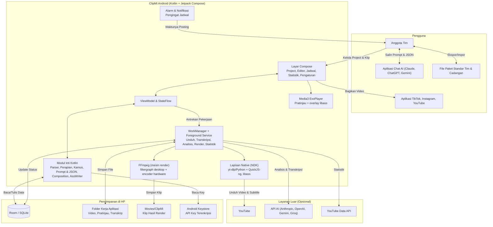
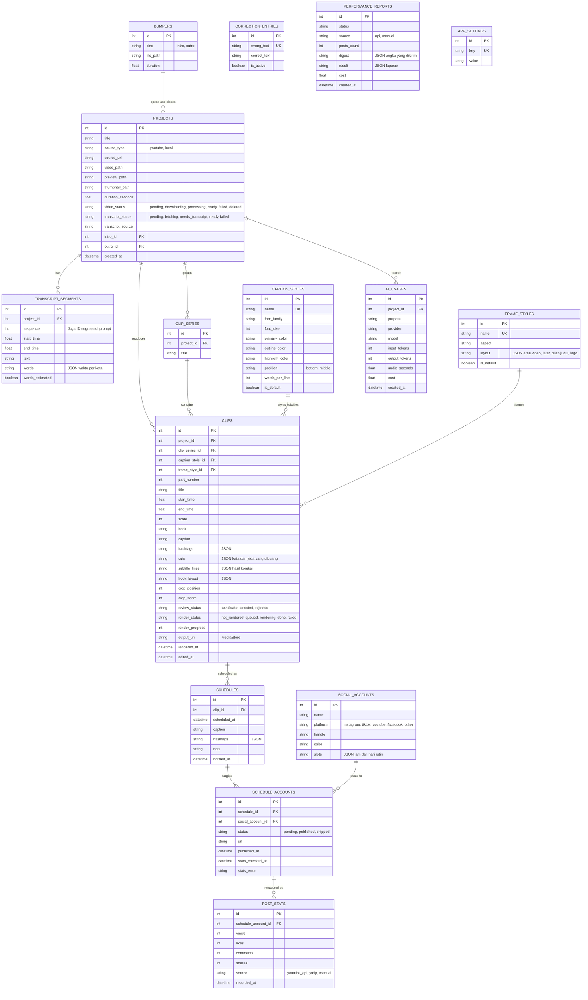

# PRD — Project Requirements Document: ClipMI Android

## 1. Overview
ClipMI desktop sudah memangkas waktu clipping kajian dan ceramah dari jam menjadi menit, tetapi hanya bisa dipakai di depan PC Windows. Padahal sebagian besar langkah akhir justru terjadi di HP: klip diunggah dari aplikasi TikTok, Instagram, dan YouTube di HP, jadwal posting diingat lewat HP, dan banyak anggota tim tidak selalu membawa laptop. **ClipMI Android** adalah aplikasi Android yang berdiri sendiri: seluruh alur ClipMI (video dan transkrip masuk, momen dipilih dengan bantuan AI, subtitle dikoreksi, klip dirender menjadi video vertikal 9:16, lalu dijadwalkan, diunggah, dan dipantau statistiknya) berjalan di HP pengguna, dengan semua data tersimpan di HP itu sendiri tanpa server, tanpa login, dan tanpa biaya langganan. Tujuannya agar anggota tim bisa membuat dan mengunggah klip kapan saja hanya dengan HP, dengan hasil yang sama rapinya dengan versi desktop, dan dengan aplikasi yang tetap ringan, cepat, dan hemat baterai.

## 2. Requirements
*   **Aplikasi Android Mandiri:** Aplikasi dipasang dari file APK dan berjalan sepenuhnya di HP pengguna, tanpa server, tanpa akun, dan tanpa berbagi data antar pengguna; koneksi internet hanya dipakai untuk mengunduh video, mengambil subtitle, memanggil API AI (opsional), dan membaca statistik postingan.
*   **Penyimpanan di HP Pengguna:** Database, video sumber, transkrip, dan file kerja disimpan di penyimpanan internal aplikasi, sedangkan klip hasil render disimpan di folder Movies/ClipMI sehingga muncul di galeri dan bisa langsung dibagikan; data bisa dicadangkan dan dipulihkan sendiri oleh pengguna.
*   **Ringan dan Cepat:** Aplikasi native (bukan WebView), render memakai encoder hardware HP, dan ukuran APK serta pemakaian memori dijaga sekecil mungkin agar tetap nyaman di HP kelas menengah.
*   **Proses Berat di Latar yang Tahan Gangguan:** Unduh video, transkripsi, analisis, dan render berjalan di latar dengan notifikasi progres, tetap jalan saat layar mati atau aplikasi ditinggal, dan bisa dilanjutkan setelah aplikasi ditutup paksa oleh sistem.
*   **Hasil Sama dengan Desktop:** Prompt analisis, format JSON hasil AI, gaya subtitle, gaya bingkai, dan tata letak layar mengikuti aturan ClipMI desktop, sehingga klip dari HP dan dari PC tampak sama dan standar tim berlaku di keduanya.
*   **Akurasi Sebelum Ekspor:** Setiap kandidat klip, rentang waktu, dan teks subtitle bisa ditinjau dan dikoreksi dengan sentuhan sebelum dirender, karena subtitle otomatis sering salah pada istilah agama dan nama tokoh.
*   **Output Siap Unggah dari HP:** Klip berformat MP4 vertikal 9:16 hingga 1080p dengan subtitle tertanam, tanpa watermark, dan bisa langsung dibagikan ke aplikasi TikTok, Instagram, atau YouTube lewat tombol bagikan Android.

## 3. Core Features
Urutan pengembangan disusun agar risiko teknis terbesar dibuktikan lebih dulu, lalu setiap fase menghasilkan alur yang sudah bisa dipakai, mengikuti urutan versi desktop dari video dan transkrip sampai jadwal dan analisis performa:

### Fase 0: Fondasi & Uji Risiko
*   **Uji Coba Teknis** [high] — Membuktikan bagian yang paling berisiko sebelum fitur dibangun di atasnya. *Selesai 17 November 2026; rincian di `docs/fase0-hasil.md`.*
    *   *Unduh YouTube di HP:* yt-dlp berjalan di dalam aplikasi (Python tertanam), termasuk kebutuhan JavaScript runtime untuk YouTube, mengunduh MP4 H.264 hingga 1080p dan subtitle json3, lalu dicatat ukuran tambahan APK dan waktu unduhnya. **Hasil:** berhasil dengan youtubedl-android (Python 3.12, yt-dlp diperbarui ke versi desktop dari aplikasi) dan QuickJS-ng sebagai JavaScript runtime; metadata + subtitle ±27 detik (tantangan JS ±16 detik di HP kelas menengah, sekali per video), video 1080p 29 menit terunduh dalam 40 detik di Wi-Fi; tambahan APK ±18 MB.
    *   *libass lewat NDK:* libass beserta FreeType, HarfBuzz, dan FriBidi dibangun dengan NDK r30 untuk arm64, lalu menggambar file ASS dari ClipMI desktop ke bitmap dengan hasil identik. **Hasil:** identik dengan filter `ass` desktop (SSIM 1,000 pada 24 frame dari 6 gaya), ±0,3 ms per frame.
    *   *Mesin Render:* Membandingkan Media3 Transformer (encoder hardware, efek GPU) dengan FFmpeg yang dibangun sendiri untuk potong, crop, subtitle, latar blur, dan rapikan audio; diukur kecepatan, suhu, ukuran APK, dan kesamaan hasil dengan desktop. **Hasil:** FFmpeg dipilih (crop 1,46x realtime, latar blur 0,75x, SSIM 0,990–0,993 terhadap desktop, audio identik, +3,75 MB); Media3 Transformer lebih lambat untuk crop, latar blurnya kurang mirip, dan tidak punya rantai audio desktop.
    *   *Uji di HP Nyata:* Semua uji coba dijalankan di minimal satu HP kelas menengah tim lewat USB atau wireless debugging. **Hasil:** Xiaomi Mi 8 Lite (Snapdragon 660, RAM 4 GB, Android 10).
*   **Kerangka Aplikasi** [high] — Fondasi yang dipakai semua fitur. *Selesai: build dan terpasang di HP uji.*
    *   *Navigasi & Tema:* Struktur layar Compose dengan navigasi bawah (Project, Jadwal, Statistik, Pengaturan), tema terang dan gelap mengikuti sistem.
    *   *Database Lokal:* Database Room (SQLite) dengan migrasi berversi, sehingga data lama aman saat aplikasi diperbarui.
    *   *Antrean Kerja:* Pekerjaan berat lewat WorkManager dengan foreground service dan notifikasi progres, satu antrean per jenis (unduh, AI, render) seperti di desktop.
    *   *Penyimpanan Aman:* API key disimpan terenkripsi dengan Android Keystore dan tidak pernah ikut dicadangkan atau diekspor.

### Fase 1: Video & Transkrip
*Berjalan (17 November 2026): project dari link/share YouTube dan dari galeri, subtitle YouTube, impor SRT/VTT, perapian transkrip identik desktop, kamus koreksi, dan Transkripsi API sudah dibangun; catatan di `docs/fase1-catatan.md`. Playlist dan video pratinjau (proxy) belum.*
*   **Manajemen Project** [high] — Wadah untuk setiap video sumber yang akan diolah menjadi klip.
    *   *Project dari Link YouTube:* Menempel link, atau membagikan video dari aplikasi YouTube ke ClipMI (share intent); metadata, thumbnail, dan subtitle diambil lebih dulu, video diunduh di latar, khusus untuk konten yang sudah mendapat izin dari pemiliknya. Ekstraksi YouTube (termasuk tantangan JavaScript) hanya sekali per video: unduhan video memakai ulang `info.json` dari langkah metadata, lalu video dan audio digabung FFmpeg tanpa encode ulang.
    *   *Project dari Galeri/File:* Memilih video dari galeri atau file manager (MP4/MOV/MKV) lewat pemilih file Android, lalu disalin ke folder kerja aplikasi.
    *   *Daftar Project:* Kartu project dengan thumbnail, judul, durasi, jumlah klip, ukuran penyimpanan, dan status proses.
    *   *Status Video & Transkrip Terpisah:* Status video (Menunggu, Mengunduh, Memproses, Siap, Gagal, Dihapus) dan status transkrip (Menunggu, Mengambil, Butuh Transkrip, Siap, Gagal) berjalan paralel, sehingga analisis bisa dimulai sebelum video selesai diunduh.
*   **Pengambilan Transkrip** [high] — Mendapatkan teks bertimestamp dari berbagai sumber.
    *   *Subtitle YouTube:* Subtitle bahasa Indonesia lewat yt-dlp, json3 diutamakan karena memuat waktu per kata, VTT sebagai cadangan, subtitle manual diutamakan di atas otomatis.
    *   *Impor SRT/VTT:* Memilih file subtitle dari HP (misalnya hasil TurboScribe yang diunduh lewat browser), dengan konfirmasi sebelum menggantikan transkrip lama.
    *   *Transkripsi Otomatis (API):* Audio diekstrak dan dikompres di HP lalu dikirim ke Groq Whisper (atau penyedia lain), dengan potongan otomatis dan jeda saat batas laju penyedia tercapai.
*   **Perapian Transkrip** [high] — Aturan yang sama dengan desktop agar hasilnya identik.
    *   *Normalisasi & Buang Teks Berulang:* Merapikan timestamp yang tumpang-tindih dan membuang teks bergulir berulang.
    *   *Gabung Menjadi Kalimat:* Segmen kalimat utuh untuk analisis, waktu per kata tetap disimpan untuk subtitle.
    *   *Estimasi Waktu Per Kata:* Perkiraan waktu kata proporsional terhadap panjang kata bila sumber tidak menyediakannya.
    *   *Tampilan & Pencarian Transkrip:* Daftar segmen yang bisa diketuk untuk memutar video di titik itu, dengan pencarian kata kunci.
*   **Kamus Koreksi** [medium] — Daftar kata salah dan kata benar yang dipakai ulang lintas project.
    *   *Kelola Kamus:* Tambah, ubah, aktifkan, dan nonaktifkan pasangan koreksi.
    *   *Terapkan Otomatis & Ulang:* Dijalankan pada transkrip baru, dan bisa diterapkan ulang ke project lama, dengan ringkasan jumlah kata yang dikoreksi.

### Fase 2: Pemilihan Momen dengan AI
*Dibangun (17 November 2026): mode manual, Mode API multi-penyedia, kandidat klip, klip manual, dan seri; prompt dan impor balasan identik dengan desktop (diuji di HP). Catatan di `docs/fase2-catatan.md`.*
*   **Analisis Mode Manual** [high] — Memakai aplikasi chat AI yang sudah ada di HP tanpa biaya API.
    *   *Salin atau Bagikan Prompt:* Prompt yang sama dengan desktop (ID segmen, timestamp, instruksi, format JSON) disalin ke clipboard atau dibagikan langsung ke aplikasi Claude, ChatGPT, atau Gemini; transkrip panjang dipecah otomatis.
    *   *Tempel Hasil JSON:* Kolom tempel dengan validasi format dan pesan error yang jelas, toleran terhadap teks pembuka dan penutup.
    *   *Pemetaan ke Timestamp:* ID segmen dikonversi ke waktu kata pertama dan terakhir, sehingga potongan selalu jatuh di batas kata.
*   **Analisis Mode API** [medium] — Analisis otomatis lewat penyedia AI pilihan.
    *   *Multi-Penyedia:* Anthropic, OpenAI, Gemini, Groq, dan endpoint kompatibel OpenAI, dengan uji koneksi tanpa memakai token.
    *   *Perkiraan Biaya & Pemakaian:* Perkiraan token dan biaya sebelum dijalankan, serta catatan pemakaian per analisis di halaman Pemakaian AI.
    *   *Lanjut Setelah Gagal:* Bagian transkrip yang sudah selesai tidak dikirim ulang, dan server yang sibuk dicoba ulang otomatis dengan jeda.
*   **Kandidat Klip** [high] — Daftar momen yang siap ditinjau.
    *   *Kartu Kandidat:* Judul, rentang waktu, durasi, skor, hook, caption, hashtag, dan alasan, diurutkan berdasarkan skor, dengan pemutaran rentang langsung di kartu.
    *   *Status Tinjauan:* Geser kartu atau ketuk untuk menandai *Terpilih* atau *Dibuang*, dengan pemulihan kandidat yang dibuang.
    *   *Sunting & Tambah Manual:* Mengubah teks kandidat, dan membuat klip sendiri dengan memilih segmen awal dan akhir dari transkrip.
    *   *Klip Berseri:* Pengelompokan seri dengan nomor bagian dan label "Bagian N" otomatis.

### Fase 3: Editor & Render
*Berjalan (17 November 2026): 3a selesai — komposisi, filtergraph FFmpeg, subtitle ASS, hook, subtitle klip, dan potongan diport ke core dan identik dengan desktop (2.900+ kasus uji). 3b selesai — render FFmpeg di HP (encoder hardware, simpan ke galeri, bagikan) diuji pada tiga gaya bingkai. 3c selesai — editor sentuh diuji di HP. 3d selesai — pengelola gaya, template, intro/outro, sampul, layar Hasil, render aman baterai/suhu, diuji di HP. Sistem desain baru (mockup) sudah diterapkan ke layar Fase 1–2. Catatan di `docs/fase3-catatan.md`.*
*   **Editor Klip Sentuh** [high] — Editor yang dirancang untuk layar HP, bukan salinan editor desktop.
    *   *Pratinjau Hidup:* ExoPlayer memutar video dengan subtitle dan hook digambar libass dari file ASS yang sama dengan render, sehingga yang terlihat sama dengan hasilnya (warna ASS ditafsirkan BT.601 TV range seperti filter `ass` FFmpeg).
    *   *Timeline Sentuh:* Tarik ujung klip, geser, cubit untuk zoom, dengan getaran halus saat menempel ke batas kata.
    *   *Potong dari Transkrip:* Ketuk kata untuk membuang atau mengembalikannya, buang jeda panjang otomatis, dan sunting teks subtitle tanpa merusak waktu per kata.
    *   *Crop & Zoom:* Geser dan cubit area video di bingkai 9:16, crop tengah, atau video utuh dengan latar blur.
    *   *Hook & Sampul:* Teks hook dengan posisi, model, dan waktu tampil yang bisa diatur, serta sampul dari frame video atau gambar galeri.
    *   *Urungkan & Ulangi:* Riwayat edit di dalam aplikasi, minimal 30 langkah.
*   **Gaya Subtitle & Gaya Bingkai** [high] — Preset tampilan yang sama dengan desktop.
    *   *Gaya Subtitle:* Font yang dibundel, ukuran, warna, garis tepi, posisi, kata per tampilan, sorotan karaoke, kata kunci berwarna, animasi, efek, dan kotak latar, dengan pratinjau libass.
    *   *Gaya Bingkai:* Rasio layar, area video, sudut membulat, latar, bilah judul, logo, dan watermark.
    *   *Intro & Outro:* Video pembuka dan penutup per project, serta kartu pembuka hook.
*   **Render Klip Vertikal** [high] — Mengubah kandidat terpilih menjadi video siap unggah.
    *   *Render Encoder Hardware:* Potong, crop, gaya bingkai, subtitle, dan hook dirender FFmpeg (hasil uji coba Fase 0) dengan filtergraph yang sama dengan `ClipRenderer` desktop dan encoder hardware HP (`h264_mediacodec`), ke MP4 H.264 hingga 1080p, dengan urutan cadangan bila encoder HP menolak format tertentu.
    *   *Satu Komposisi untuk Pratinjau dan Render:* Tata letak layar dihitung sekali (padanan `Composition` desktop) dan dipakai bersama oleh pratinjau dan render; untuk render ia menghasilkan filtergraph FFmpeg yang sama dengan desktop.
    *   *Rapikan Audio:* Volume disamakan dengan standar platform, dengung frekuensi rendah dibuang, dan noise latar dikurangi ringan.
    *   *Render Massal & Aman Baterai:* Beberapa klip dirender berurutan dengan progres per klip di notifikasi, dijeda otomatis saat baterai sangat rendah atau HP terlalu panas.
*   **Hasil & Bagikan** [high] — Mengelola klip yang sudah jadi.
    *   *Galeri Hasil:* Klip tersimpan di Movies/ClipMI dan langsung muncul di galeri HP.
    *   *Bagikan ke Aplikasi Sosmed:* Tombol bagikan Android membuka TikTok, Instagram, atau YouTube dengan video terlampir, sementara caption dan hashtag disalin ke clipboard.
    *   *Peringatan Render Usang:* Tanda bila klip diubah setelah dirender atau file hasilnya hilang.

### Fase 4: Jadwal, Unggah & Statistik
*Selesai (18 November 2026): logika jadwal, Isi otomatis, pengingat, dan statistik diport ke core dan identik dengan desktop (1.900+ kasus uji); akun sosmed, kalender minggu/bulan, antrean, pengingat alarm dengan notifikasi, Siap Unggah, dan tab Statistik diuji di HP. Catatan di `docs/fase4-catatan.md`.*
*   **Jadwal Posting** [high] — Perencanaan posting pribadi di HP, sama konsepnya dengan desktop.
    *   *Akun Sosmed:* Daftar akun (nama, platform, handle, warna) dengan slot rutin per akun.
    *   *Kalender & Antrean:* Tampilan minggu dan bulan, antrean klip siap unggah, dan "Isi otomatis" yang mengisi slot kosong dengan urutan seri terjaga.
    *   *Satu Jadwal, Banyak Akun:* Satu jadwal untuk beberapa akun dengan status per akun (Menunggu, Sudah terbit, Dilewati), caption khusus, dan penghitung batas teks tiap platform.
*   **Pengingat & Unggah Cepat** [high] — Keunggulan utama versi HP dibanding desktop.
    *   *Notifikasi Tepat Waktu:* Pengingat "Waktunya posting" lewat alarm sistem, tetap muncul walaupun aplikasi tertutup, dengan tombol aksi langsung di notifikasi.
    *   *Unggah dari Notifikasi:* Ketuk notifikasi untuk membuka layar Siap Unggah: bagikan video ke aplikasi platform, caption tersalin, lalu tandai terbit.
    *   *Jadwal Terlewat:* Jadwal yang lewat ditampilkan dengan pilihan Unggah sekarang atau Jadwalkan ulang ke slot berikutnya.
*   **Statistik Postingan** [medium] — Mengukur hasil dari link postingan.
    *   *Ambil dari Link:* Tayangan, suka, komentar, dan share dibaca lewat YouTube Data API (opsional) atau yt-dlp; Instagram dan Facebook diisi manual.
    *   *Pembaruan Berkala:* Diperbarui otomatis di latar mengikuti umur postingan sampai hari ke-31, dengan progres saat diperbarui manual.
    *   *Tampilan Statistik:* Total, median, dan tayangan terbaik per akun, engagement, serta tayangan hari ke-1/7/30.

### Fase 5: Analisis, Standar Tim & Distribusi
*Berjalan (18 November 2026): Analisis Performa dan Paket Standar Tim diport ke core dan identik dengan desktop (360 balasan, 304 paket); Cadangkan & Pulihkan, Penyimpanan & perawatan, kunci rilis, dan pembaruan dalam aplikasi sudah dibuat. Cadangan, pratinjau pulihkan, Paket Standar Tim (juga dibaca desktop), hapus/pilih ulang video sumber, dan Analisis Performa mode chat AI diuji di HP. Catatan di `docs/fase5-catatan.md`.*
*   **Analisis Performa AI** [medium] — Kekuatan, kelemahan, dan strategi dari postingan sendiri.
    *   *Angka Diolah Aplikasi:* Postingan dibandingkan dengan median akunnya pada umur yang sama, lalu dikelompokkan per faktor (durasi, jam posting, model hook, dan lainnya).
    *   *Laporan dengan Bukti:* AI menafsirkan ringkasan itu dan setiap poin menyebut postingan buktinya, lewat Mode API atau chat AI, dengan laporan tersimpan bertanggal.
*   **Pencadangan & Pindah HP** [high] — Karena data hanya ada di HP, pengguna harus bisa menyelamatkannya sendiri.
    *   *Cadangkan:* Mengekspor database, gaya, kamus, dan pengaturan (tanpa API key) ke satu file di penyimpanan HP atau Google Drive pilihan pengguna, dengan opsi menyertakan klip hasil render.
    *   *Pulihkan:* Memulihkan dari file cadangan di HP yang sama atau HP baru, dengan pratinjau isi sebelum ditimpa.
*   **Paket Standar Tim** [medium] — Menyamakan konfigurasi antar anggota tim.
    *   *Ekspor & Impor:* Template prompt, gaya subtitle, gaya bingkai, dan kamus koreksi dalam format file yang sama dengan desktop, sehingga paket dari PC bisa dipakai di HP dan sebaliknya.
*   **Penyimpanan & Perawatan** [medium] — Menjaga HP tetap lega.
    *   *Ringkasan Penyimpanan:* Ukuran file per project dan sisa ruang HP.
    *   *Hapus & Pulihkan Sumber:* Menghapus video sumber setelah klip selesai, dan mengunduh atau memilih ulang bila perlu dirender ulang.
    *   *Perbarui yt-dlp:* Memperbarui yt-dlp dari dalam aplikasi, karena YouTube sering berubah (terbukti di Fase 0: ±2 detik ke versi stabil terbaru).
*   **Distribusi & Pembaruan** [medium] — Pemasangan di HP anggota tim tanpa Play Store.
    *   *APK Bertanda Tangan:* APK rilis ditandatangani dengan kunci tim dan diunggah ke rilis GitHub seperti installer desktop.
    *   *Pembaruan Dalam Aplikasi:* Aplikasi memeriksa rilis baru, mengunduh APK, dan meminta konfirmasi pemasangan dari sistem.
    *   *Verifikasi Developer:* Mendaftarkan tim sebagai developer terverifikasi Android sebelum aturan verifikasi berlaku menyeluruh (diumumkan mulai 2027), agar pemasangan APK tidak diblokir atau diberi peringatan.

## 4. User Flow
**Skenario Anggota Tim (Clipping dari Link YouTube di HP):**
1. Anggota tim membuka video kajian di aplikasi YouTube, mengetuk Bagikan, lalu memilih ClipMI; project baru langsung dibuat.
2. ClipMI mengambil subtitle dan menerapkan kamus koreksi; video diunduh di latar dengan progres di notifikasi, sementara HP bisa dipakai untuk hal lain.
3. Begitu transkrip siap, anggota tim mengetuk "Analisis": dengan Mode API kandidat muncul sendiri, atau dengan mode manual prompt dibagikan ke aplikasi chat AI dan balasannya ditempel kembali.
4. Anggota tim menonton tiap kandidat di kartunya, menggeser kartu untuk menandai *Terpilih* atau *Dibuang*.
5. Untuk kandidat terpilih, editor dibuka: ujung klip ditarik bila perlu, kata yang salah diketuk dan dikoreksi, crop digeser dengan jari, dan gaya subtitle serta bingkai dipilih.
6. Anggota tim mengetuk Render; klip dirender dengan encoder hardware di latar, lalu tersimpan di galeri.
7. Dari layar hasil, klip dijadwalkan ke beberapa akun sekaligus, atau langsung dibagikan ke TikTok dengan caption yang sudah tersalin.

**Skenario Anggota Tim (Posting Terjadwal & Statistik):**
1. Anggota tim mengatur slot rutin tiap akun (misalnya 07.00 dan 19.00), lalu mengetuk "Isi otomatis" untuk membagikan klip antrean ke slot kosong.
2. Saat waktunya tiba, notifikasi "Waktunya posting" muncul walaupun ClipMI tertutup.
3. Mengetuk notifikasi membuka layar Siap Unggah; anggota tim membagikan video ke aplikasi platform dan menempel caption yang sudah tersalin.
4. Setelah terbit, link postingan ditempel di ClipMI; postingan otomatis ditandai terbit dan statistiknya diambil.
5. Statistik diperbarui sendiri di latar; anggota tim melihat tayangan hari ke-1/7/30 dan perbandingannya dengan median akun.
6. Setelah ada cukup postingan, anggota tim menjalankan Analisis Performa dan membaca kekuatan, kelemahan, dan eksperimen berikutnya beserta postingan buktinya.

**Skenario Koordinator Tim (Pemasangan & Standarisasi):**
1. Koordinator membagikan link rilis APK kepada anggota tim.
2. Anggota tim mengizinkan pemasangan dari sumber tersebut, memasang ClipMI, dan membuka halaman Cek Kesehatan untuk memastikan yt-dlp dan encoder berjalan.
3. Koordinator mengekspor Paket Standar Tim dari ClipMI desktop atau Android, lalu membagikannya lewat WhatsApp atau Drive.
4. Anggota tim mengimpor paket itu di Pengaturan; template prompt, gaya, dan kamus langsung sama dengan tim.
5. Secara berkala anggota tim membuat cadangan data ke Google Drive pribadi, terutama sebelum berganti HP.

## 5. Architecture
Aplikasi dibangun sebagai **aplikasi Android native satu APK** dengan Kotlin dan Jetpack Compose, memakai pola MVVM dengan aliran data satu arah (ViewModel, StateFlow, coroutine). Logika inti dipisah ke modul Kotlin murni yang bisa diuji tanpa HP: parser transkrip, perapian, kamus koreksi, pembuat prompt dan pembaca JSON, `Composition`, dan penulis ASS. Modul inti ini adalah padanan langsung kode desktop dan dikunci dengan tes perbandingan output dari fixture desktop, sehingga hasilnya tetap identik. Pekerjaan berat dijalankan WorkManager dengan foreground service, sementara bagian native dibundel di APK: yt-dlp lewat Python tertanam dengan QuickJS-ng untuk tantangan JavaScript YouTube, libass (lewat JNI) untuk subtitle, dan FFmpeg buatan sendiri sebagai mesin render (executable di folder library aplikasi, satu-satunya lokasi yang boleh dijalankan di Android 10+). Media3 ExoPlayer dipakai untuk pratinjau. Setiap HP memiliki database Room (SQLite) dan folder kerjanya sendiri sebagai sumber kebenaran tunggal, sedangkan klip hasil render ditulis ke MediaStore agar bisa dibagikan ke aplikasi lain. Pendekatan ini cocok karena tim bekerja sendiri-sendiri, video tidak perlu diunggah ke mana pun, tidak ada biaya server, dan aplikasi native memberi performa dan efisiensi baterai terbaik untuk pemrosesan video di HP.

## 6. Database Schema
Karena aplikasi dipakai per HP tanpa login, tidak ada tabel pengguna. Skema mengikuti ClipMI desktop agar Paket Standar Tim dan logika inti bisa dipakai bersama, dengan nilai status berbahasa Inggris di database dan label Indonesia di layar. Tabel inti: **Projects** (video sumber, asal, status video dan transkrip), **Transcript_Segments** (segmen kalimat dengan waktu per kata), **Clip_Series** (pengelompokan klip berseri), **Clips** (kandidat dan hasil klip, potongan, crop, hook, subtitle hasil koreksi, status render), **Caption_Styles** dan **Frame_Styles** (preset tampilan), **Bumpers** (intro dan outro), **Correction_Entries** (kamus koreksi), **Social_Accounts**, **Schedules**, dan **Schedule_Accounts** (jadwal posting per akun), **Post_Stats** (statistik bertanggal), **Performance_Reports** (laporan analisis AI), **Ai_Usages** (catatan pemakaian API), dan **App_Settings** (konfigurasi key-value; API key disimpan terpisah di Keystore).

## 7. Tech Stack
Pemilihan teknologi difokuskan pada aplikasi yang ringan, cepat, dan hemat baterai untuk pemrosesan video di HP kelas menengah, tanpa biaya server maupun lisensi, dan bisa dirawat bersama ClipMI desktop. Karena kode ditulis oleh Claude, bahasa dan framework dipilih murni dari sisi performa dan kecocokan dengan API Android, bukan dari kebiasaan tim. Versi di bawah sudah dicek tersedia dan berhasil dibuild di PC pengembangan pada 17 November 2026.

*   **Bahasa & UI:** Kotlin 2.4 + Jetpack Compose (BOM 2026.09) dengan Material 3 — Native tanpa WebView, sehingga ringan dan responsif, dan tetap fleksibel untuk desain editor sentuh.
*   **Arsitektur Aplikasi:** MVVM, coroutine, dan StateFlow, dengan dependency injection manual — Tanpa framework DI supaya build dan waktu buka aplikasi tetap ringan.
*   **Pemutar Video:** Media3 1.11 ExoPlayer untuk pratinjau — Jalur resmi Google untuk pemutaran video di Android. Transformer diuji di Fase 0 tetapi tidak dipakai untuk render (lebih lambat untuk crop, latar blur kurang mirip desktop, tanpa rantai audio desktop).
*   **Render Video:** FFmpeg 8.1 (versi sama dengan desktop) yang dibangun sendiri dengan NDK r30, lisensi LGPL, encoder hardware `h264_mediacodec` — Filtergraph `ClipRenderer` desktop dipakai hampir apa adanya, hasil paling mirip desktop (SSIM 0,99) dan audio identik; ffmpeg-kit sudah dihentikan, jadi versi dan komponennya dikontrol sendiri (+3,75 MB). `boxblur` desktop (GPL) diganti `avgblur` dua kali.
*   **Subtitle:** libass 0.17.5 (dengan FreeType, HarfBuzz, FriBidi) dibangun dengan NDK r30 untuk arm64 — Mesin subtitle yang sama dengan desktop; hasilnya terbukti identik, sehingga pratinjau dan hasil render sama.
*   **Unduh YouTube:** yt-dlp lewat Python tertanam (youtubedl-android 0.18) dengan QuickJS-ng sebagai JavaScript runtime untuk tantangan YouTube (desktop memakai Deno) — Satu-satunya cara andal mengunduh video dan subtitle YouTube di HP, dengan pembaruan yt-dlp dari dalam aplikasi.
*   **Database & Data:** Room (SQLite) untuk data utama dan DataStore untuk preferensi ringan — Tanpa server, satu database per HP, dengan migrasi berversi yang aman saat update.
*   **Jaringan:** OkHttp dengan kotlinx.serialization — Ringan untuk memanggil API AI, Groq, dan YouTube Data API.
*   **Pekerjaan Latar & Pengingat:** WorkManager dengan foreground service, dan AlarmManager untuk notifikasi jadwal — Proses berat tahan gangguan, dan pengingat tetap muncul walaupun aplikasi tertutup.
*   **Keamanan:** Android Keystore untuk API key — Key terenkripsi di perangkat dan tidak ikut cadangan maupun paket tim.
*   **Build & Tooling:** Gradle 9.9 dengan Android Gradle Plugin 9.5, JDK 21, Android SDK 37, dan NDK r30, dijalankan lewat baris perintah; library native dibangun lewat MSYS2 (`native/build-native.sh`) — Sudah terpasang dan teruji di PC pengembangan, tanpa perlu Android Studio.
*   **Distribusi:** APK bertanda tangan di rilis GitHub dengan pembaruan dalam aplikasi — Tanpa Play Store, karena aplikasi pengunduh YouTube tidak diizinkan di sana.

---

**Asumsi yang dipakai dalam PRD ini (bisa dikoreksi):**
*   Target HP Android 10 (API 29) atau lebih baru dengan prosesor 64-bit (arm64), RAM minimal 4 GB, dan ruang kosong minimal 5 GB untuk video sumber.
*   Klip hasil render 1080p H.264 seperti desktop; HP yang encoder-nya tidak mampu 1080p turun ke 720p dengan pemberitahuan.
*   Input dari YouTube hanya untuk konten yang sudah mendapat izin dari pemiliknya.
*   Aplikasi tidak didistribusikan lewat Play Store; pemasangan lewat APK dari rilis GitHub, dan tim mendaftar sebagai developer terverifikasi Android sebelum aturan verifikasi berlaku menyeluruh.
*   Data HP dan PC tidak tersinkron otomatis; yang dipakai bersama hanya Paket Standar Tim dan file cadangan.
*   Pelacakan penceramah otomatis (crop mengikuti wajah) menyusul setelah Fase 3, memakai deteksi wajah di perangkat, karena desktop memakai model di browser yang tidak bisa dipakai ulang langsung.
*   Keputusan Fase 0 (17 November 2026, diuji di Xiaomi Mi 8 Lite): render dengan FFmpeg, pratinjau dengan ExoPlayer + libass, yt-dlp lewat youtubedl-android + QuickJS-ng. Ukuran APK rilis ±28 MB (±55 MB terpasang). HP yang encoder hardware-nya menolak FFmpeg/MediaCodec perlu jalur cadangan yang ditentukan di Fase 3.
